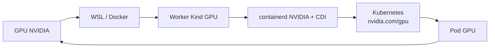

# Extension AI

Le répertoire `ai/` complète le socle `core` afin de permettre l'exécution locale de workloads Kubernetes utilisant un GPU NVIDIA.

L'extension fournit une **capacité Kubernetes GPU**. Elle ne déploie volontairement aucun moteur d'inférence ni composant applicatif IA tel que vLLM, Ollama, LiteLLM ou llm-d.

## Composants

L'extension AI fournit :

- la vérification de l'accès au GPU depuis l'hôte ;
- la vérification de l'accès au GPU depuis Docker ;
- une image Kind intégrant NVIDIA Container Toolkit ;
- un worker Kind dédié au GPU ;
- la configuration NVIDIA du containerd du worker ;
- le support CDI ;
- NVIDIA Device Plugin ;
- l'exposition de `nvidia.com/gpu` dans Kubernetes ;
- un test fonctionnel exécutant `nvidia-smi` depuis un pod ;
- le nettoyage de l'image Kind NVIDIA lors du `destroy`.

## Prérequis

L'extension AI nécessite les prérequis du socle `core` ainsi que :

| Composant | Usage |
|---|---|
| GPU NVIDIA | accélérateur utilisé par les workloads |
| Pilote NVIDIA | accès au GPU depuis l'hôte |
| WSL2 GPU support | accès au GPU depuis Linux sous WSL2 |
| Docker GPU support | accès au GPU depuis les containers Docker |
| NVIDIA Container Toolkit | intégration NVIDIA aux runtimes de containers |

Vérification :

```bash
platform-bootstrap doctor-ai
```

Cette commande contrôle notamment :

```text
WSL/Linux
  ↓
nvidia-smi

Docker
  ↓
container CUDA
  ↓
nvidia-smi
```

Si ces vérifications échouent, le problème se situe avant Kubernetes.

## Architecture GPU

Le chemin d'accès au GPU traverse plusieurs couches :



Deux mécanismes complémentaires interviennent :

```text
NVIDIA Device Plugin
        ↓
publie nvidia.com/gpu dans Kubernetes
```

et :

```text
NVIDIA Container Toolkit + CDI
        ↓
permet au container d'accéder réellement au GPU
```

Le Device Plugin rend donc le GPU **planifiable** par Kubernetes, tandis que le runtime NVIDIA et CDI permettent son **utilisation effective** par le container.

## Image Kind NVIDIA

Les nodes Kind standards utilisent l'image définie dans :

```text
core/versions.env
```

Le worker GPU utilise une image spécifique construite à partir de cette même image Kind.

Exemple :

```text
kindest/node:v1.37.0
        ↓
NVIDIA Container Toolkit
        ↓
platform-kind-nvidia:v1.37.0-nvidia-<version>
```

Les fichiers associés sont :

```text
ai/kind/Dockerfile
ai/versions.env
```

Construction manuelle :

```bash
platform-bootstrap build-ai-node-image
```

La version Kubernetes reste définie uniquement dans `core/versions.env`.

Les versions spécifiques au GPU restent définies dans `ai/versions.env`.

## Worker GPU

Le bootstrap AI crée un cluster Kind composé de :

```text
control-plane
worker
worker GPU
```

Le worker GPU :

- utilise l'image Kind NVIDIA ;
- possède le label `nvidia.com/gpu.present=true` ;
- partage les informations CDI de l'hôte ;
- exécute un containerd configuré avec le runtime NVIDIA.

Le template source est :

```text
ai/kind/kind-gpu.yaml.tpl
```

Génération ciblée :

```bash
platform-bootstrap -n my-platform kind-ai-config
```

Création :

```bash
platform-bootstrap -n my-platform kind-ai-create
```

## CDI

CDI signifie **Container Device Interface**.

CDI permet de décrire de manière standard comment un device doit être rendu disponible dans un container.

Pour un GPU NVIDIA, cela permet notamment au runtime de connaître les devices, mounts et composants nécessaires à l'utilisation du GPU.

Le bootstrap rend accessibles au worker Kind les spécifications CDI présentes sur l'hôte :

```text
/etc/cdi
```

Le template Kind utilise notamment :

```yaml
extraMounts:
  - hostPath: /var/run/nvidia-container-devices/all
    containerPath: /var/run/nvidia-container-devices/all

  - hostPath: /etc/cdi
    containerPath: /etc/cdi
    readOnly: true
```

Le premier montage permet l'injection NVIDIA lors de la création du node Kind.

Le second rend les spécifications CDI disponibles dans le worker GPU.

Schématiquement :

```text
Docker hôte
    ↓
worker Kind
    ↓
CDI + runtime NVIDIA
    ↓
containerd
    ↓
pod GPU
```

## NVIDIA Container Toolkit

NVIDIA Container Toolkit est installé directement dans l'image Kind GPU.

Il fournit notamment les outils nécessaires à la configuration du runtime NVIDIA.

Le bootstrap utilise :

```text
nvidia-ctk runtime configure
```

pour configurer le containerd du worker GPU.

Commande ciblée :

```bash
platform-bootstrap -n my-platform configure-ai-containerd
```

Le runtime NVIDIA devient alors le runtime utilisé par containerd pour les workloads du node GPU.

Cette configuration est vérifiée par `verify-ai`.

## NVIDIA Device Plugin

NVIDIA Device Plugin est déployé dans Kubernetes sous forme de DaemonSet.

Son rôle principal est de publier la ressource :

```text
nvidia.com/gpu
```

dans le statut du node.

On retrouve notamment :

```text
status.capacity.nvidia.com/gpu
status.allocatable.nvidia.com/gpu
```

Un workload peut ensuite demander un GPU :

```yaml
resources:
  limits:
    nvidia.com/gpu: 1
```

Installation ciblée :

```bash
platform-bootstrap -n my-platform install-ai-device-plugin
```

## Cycle de bootstrap AI

La commande :

```bash
platform-bootstrap -n my-platform bootstrap-ai
```

enchaîne :

```text
doctor
  ↓
doctor-ai
  ↓
instance-save
  ↓
build-ai-node-image
  ↓
kind-ai-create
  ↓
configure-ai-containerd
  ↓
registry-create
  ↓
registry-configure-kind
  ↓
crossplane-install
  ↓
crossplane-verify
  ↓
install-ai-device-plugin
  ↓
verify-ai
```

Le bootstrap AI crée directement un cluster Kind adapté au GPU.

Il ne consiste pas à créer d'abord un cluster standard puis à le transformer.

## Profil d'instance

Une instance AI est enregistrée avec :

```text
PLATFORM_BOOTSTRAP_PROFILE=ai
```

dans :

```text
~/.local/state/platform-bootstrap/<instance>/instance.env
```

Exemple :

```text
PLATFORM_BOOTSTRAP_NAME=my-platform
PLATFORM_BOOTSTRAP_PROFILE=ai
KIND_CLUSTER=my-platform
KIND_HTTP_PORT=8080
KIND_HTTPS_PORT=8443
REGISTRY_NAME=my-platform-registry
REGISTRY_HOST=registry.my-platform.local
REGISTRY_PORT=5001
```

Le profil permet notamment au `destroy` d'appliquer le nettoyage spécifique à l'extension AI.

## Vérification

La commande :

```bash
platform-bootstrap -n my-platform verify-ai
```

contrôle :

- la présence du worker GPU ;
- son label NVIDIA ;
- le runtime NVIDIA de containerd ;
- l'état du Device Plugin ;
- la publication de `nvidia.com/gpu` ;
- les valeurs `capacity` et `allocatable`.

Exemple :

```text
==> Vérification du bootstrap AI
  [OK] Worker GPU détecté : my-platform-worker2
  [OK] Label GPU présent
  [OK] Runtime NVIDIA actif dans containerd
  [OK] NVIDIA Device Plugin prêt : 1/1
==> Attente de l'exposition du GPU dans Kubernetes
  [OK] GPU Kubernetes exposé
       Capacity    : 1
       Allocatable : 1

AI bootstrap READY.
```

Le Device Plugin peut être prêt quelques secondes avant la publication effective de `nvidia.com/gpu`.

`verify-ai` effectue donc une attente active avant de déclarer un échec.

## Test fonctionnel

La commande :

```bash
platform-bootstrap -n my-platform test-ai
```

crée temporairement un pod demandant :

```yaml
resources:
  limits:
    nvidia.com/gpu: 1
```

Le pod exécute ensuite :

```text
nvidia-smi
```

Exemple de résultat :

```text
==> Test fonctionnel GPU
==> Création d'un pod demandant 1 GPU NVIDIA
...
==> Résultat nvidia-smi
... NVIDIA GeForce RTX 5090 ...

[OK] Un workload Kubernetes a consommé le GPU NVIDIA.

AI functional test PASSED.
```

Le pod est supprimé automatiquement à la fin du test.

Ce test complète `verify-ai` en validant l'utilisation réelle du GPU depuis un workload Kubernetes.

## Commandes

### Bootstrap complet

```bash
platform-bootstrap -n my-platform bootstrap-ai
```

### Vérification des prérequis GPU

```bash
platform-bootstrap doctor-ai
```

### Construction de l'image Kind NVIDIA

```bash
platform-bootstrap build-ai-node-image
```

### Configuration Kind AI

```bash
platform-bootstrap -n my-platform kind-ai-config
```

### Création du cluster

```bash
platform-bootstrap -n my-platform kind-ai-create
```

### Configuration containerd NVIDIA

```bash
platform-bootstrap -n my-platform configure-ai-containerd
```

### Installation du Device Plugin

```bash
platform-bootstrap -n my-platform install-ai-device-plugin
```

### Vérification

```bash
platform-bootstrap -n my-platform verify-ai
```

### Test fonctionnel

```bash
platform-bootstrap -n my-platform test-ai
```

Les commandes ciblées sont principalement destinées au développement et au diagnostic.

Pour un usage normal, privilégier `bootstrap-ai`.

## Destruction

La commande est identique pour les profils standard et AI :

```bash
platform-bootstrap -n my-platform destroy
```

Pour une instance AI :

```text
lecture du profil
  ↓
destroy du core
  ↓
suppression du cluster
  ↓
suppression de l'état
  ↓
nettoyage de l'image Kind NVIDIA
```

L'image NVIDIA n'est supprimée que lorsqu'aucun autre container ne l'utilise.

Cela permet de conserver le support de plusieurs instances AI locales utilisant la même image.

## Structure

```text
ai/
├── Makefile
├── README.md
├── versions.env
├── kind/
│   ├── Dockerfile
│   └── kind-gpu.yaml.tpl
└── scripts/
    ├── doctor.sh
    ├── build-node-image.sh
    ├── kind-config.sh
    ├── kind-create.sh
    ├── configure-containerd.sh
    ├── install-device-plugin.sh
    ├── verify.sh
    ├── test.sh
    └── remove-node-image.sh
```

## Troubleshooting

### GPU inaccessible depuis l'hôte

```bash
nvidia-smi
```

Si cette commande échoue, vérifier le pilote NVIDIA et l'intégration GPU WSL2.

### GPU inaccessible depuis Docker

```bash
platform-bootstrap doctor-ai
```

Si `nvidia-smi` fonctionne sous WSL mais échoue dans Docker, vérifier l'intégration NVIDIA de Docker.

### Worker GPU absent

```bash
docker ps \
  --filter "label=io.x-k8s.kind.cluster=my-platform"
```

Un node doit utiliser l'image :

```text
platform-kind-nvidia:<version>
```

### Runtime NVIDIA absent

```bash