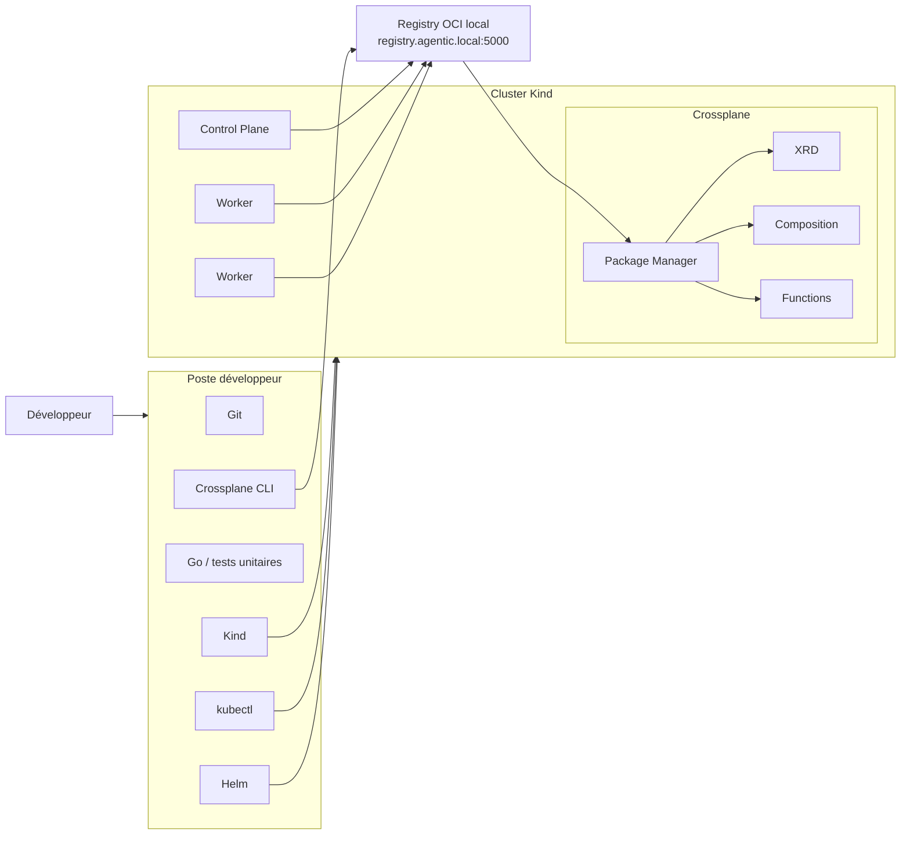

# Développement local avec Crossplane

Ce document décrit le workflow de développement local d'un composant de plateforme basé sur Crossplane.

Il complète le bootstrap technique décrit dans `bootstrap/README.md` et couvre le cycle allant de l'initialisation d'un projet jusqu'au test réel d'une XR.

## 1. Vue d'ensemble

Le poste développeur fournit les outils de développement et pilote le cluster Kind local.

Le registry OCI local sert de point de passage entre le build des packages et leur consommation par Crossplane.



Le workflow cible est :

```text
initialisation
    ↓
développement
    ↓
tests unitaires
    ↓
crossplane project build
    ↓
push OCI
    ↓
installation dans Crossplane
    ↓
validation XRD / Composition / Functions
    ↓
création d'une XR
    ↓
réconciliation
    ↓
test fonctionnel réel
```

## 2. Préparer l'environnement local

Depuis la racine du repository :

```bash
make -C bootstrap doctor
make -C bootstrap bootstrap
make -C bootstrap verify
```

Le développement ne doit commencer que lorsque :

```text
Bootstrap READY.
```

est obtenu.

## 3. Initialiser un projet Crossplane

Pour un nouveau composant, Crossplane CLI permet d'initialiser un projet :

```bash
crossplane project init
```

La commande génère la structure de base d'un projet Crossplane.

Le projet peut ensuite contenir notamment :

- des XRD ;
- des Compositions ;
- des Functions embarquées ;
- les dépendances nécessaires au projet ;
- un fichier `crossplane-project.yaml`.

Le repository OCI cible est défini dans `crossplane-project.yaml`.

Exemple conceptuel :

```yaml
spec:
  repository: registry.agentic.local:5000/agentic-platform/my-project
```

Le repository déclaré lors du build doit être identique à celui utilisé lors du push, car il influence les références générées pour les Functions embarquées.

## 4. Développer et tester une Function

Pour les Functions écrites en Go, les tests unitaires doivent être exécutés indépendamment du cluster autant que possible.

Exemple :

```bash
go test ./...
```

L'objectif est de tester localement la logique de composition avant de dépendre de Kubernetes ou de Crossplane.

Pour une Function de composition, les tests doivent notamment vérifier :

- la lecture de la XR observée ;
- la génération des ressources désirées ;
- les champs obligatoires ;
- les valeurs par défaut ;
- les erreurs attendues ;
- les cas limites significatifs.

Le cluster local intervient ensuite pour les tests d'intégration.

## 5. Construire le projet

Depuis le répertoire du projet :

```bash
crossplane project build
```

Le CLI :

1. collecte les ressources du projet ;
2. résout les dépendances ;
3. génère les schemas nécessaires ;
4. construit les Functions embarquées ;
5. construit la Configuration ;
6. génère le package dans `_output/`.

Exemple :

```text
_output/crossplane-model-serving.xpkg
```

Pour surcharger ponctuellement le repository :

```bash
crossplane project build   --repository=registry.agentic.local:5000/agentic-platform/my-project
```

La même valeur doit alors être utilisée au moment du push.

## 6. Publier le projet dans le registry OCI local

Exemple :

```bash
crossplane project push   --tag=v0.1.0   --insecure-skip-tls-verify
```

Le push publie :

- la Configuration principale ;
- les Functions embarquées.

`--insecure-skip-tls-verify` est utilisé uniquement pour la CLI locale tant que la CA de développement n'est pas intégrée au trust système du poste.

Le cluster Kind et Crossplane utilisent quant à eux explicitement la CA créée par le bootstrap.

### Vérifier le registry

Depuis la racine du repository :

```bash
curl   --cacert ${XDG_STATE_HOME:-$HOME/.local/state}/platform-bootstrap/registry/certs/domain.crt   https://registry.agentic.local:5000/v2/_catalog
```

Exemple de repositories :

```text
agentic-platform/crossplane-model-serving
agentic-platform/crossplane-model-serving_compose-vllm
```

Pour vérifier les tags :

```bash
curl   --cacert ${XDG_STATE_HOME:-$HOME/.local/state}/platform-bootstrap/registry/certs/domain.crt   https://registry.agentic.local:5000/v2/agentic-platform/crossplane-model-serving/tags/list
```

## 7. Installer la Configuration dans Crossplane

Créer un manifest Kubernetes pointant vers le package local.

Exemple :

```yaml
apiVersion: pkg.crossplane.io/v1
kind: Configuration
metadata:
  name: crossplane-model-serving
spec:
  package: registry.agentic.local:5000/agentic-platform/crossplane-model-serving:v0.1.2
```

Installation :

```bash
kubectl apply -f configuration.yaml
```

Suivre l'état :

```bash
kubectl get configurations.pkg.crossplane.io -w
```

L'état attendu est :

```text
INSTALLED   HEALTHY
True        True
```

## 8. Vérifier les artefacts installés

### Configuration

```bash
kubectl get configurations.pkg.crossplane.io
```

### Functions

```bash
kubectl get functions.pkg.crossplane.io
```

Les Functions doivent être :

```text
INSTALLED=True
HEALTHY=True
```

### XRD

```bash
kubectl get xrd
```

Les XRD doivent être établies :

```text
ESTABLISHED=True
```

### Compositions

```bash
kubectl get compositions
```

Vérifier que la Composition cible référence le bon `XR-KIND` et la bonne `XR-APIVERSION`.

### Conditions détaillées

```bash
kubectl get configuration.pkg.crossplane.io <name>   -o jsonpath='{range .status.conditions[*]}{.type}{" => "}{.status}{" | "}{.reason}{" | "}{.message}{"\n"}{end}'
```

Pour une Function :

```bash
kubectl get function.pkg.crossplane.io <name>   -o jsonpath='{range .status.conditions[*]}{.type}{" => "}{.status}{" | "}{.reason}{" | "}{.message}{"\n"}{end}'
```

## 9. Tester le pull OCI depuis un node

Pour diagnostiquer indépendamment Crossplane, il est possible de tester directement le pull depuis containerd.

Exemple :

```bash
docker exec agentic-platform-worker2   ctr -n k8s.io images pull   --hosts-dir /etc/containerd/certs.d   registry.agentic.local:5000/agentic-platform/crossplane-model-serving_compose-vllm:v0.1.2
```

Ce test permet d'isoler les problèmes liés :

- au DNS ;
- au certificat TLS ;
- à la configuration `hosts.toml` ;
- au registry OCI ;
- au runtime containerd.

## 10. Instancier une XR

Une fois la Configuration installée et saine, le test d'intégration consiste à créer une XR conforme à l'XRD exposée.

Exemple pour `ModelServing` :

```yaml
apiVersion: serving.agentic-platform.io/v1alpha1
kind: ModelServing
metadata:
  name: qwen-test
spec:
  model: Qwen/Qwen3-0.6B
  runtime: vllm
```

Application :

```bash
kubectl apply -f model-serving.yaml
```

Suivre la XR :

```bash
kubectl get modelserving qwen-test
```

Conditions détaillées :

```bash
kubectl get modelserving qwen-test   -o jsonpath='{range .status.conditions[*]}{.type}{" => "}{.status}{" | "}{.reason}{" | "}{.message}{"\n"}{end}'
```

## 11. Limite entre test du control plane et test fonctionnel réel

L'installation d'une Configuration Crossplane peut être validée indépendamment des infrastructures qu'elle produit.

Dans le cas de `ModelServing`, les étapes suivantes peuvent être testées sur le bootstrap générique :

```text
build projet
→ push OCI
→ installation Configuration
→ installation Functions
→ établissement XRD
→ installation Composition
```

La création effective d'une XR `ModelServing` déclenche en revanche la génération des ressources nécessaires au runtime vLLM.

Le test fonctionnel réel nécessite donc que la couche d'exécution correspondante soit installée au préalable.

Pour `ModelServing`, cela signifie notamment que l'environnement doit disposer des composants nécessaires au runtime GPU/vLLM avant de considérer l'instanciation de la XR comme un test end-to-end.

Cette distinction permet de séparer :

```text
tests du control plane Crossplane
```

de :

```text
tests fonctionnels de la plateforme IA
```

## 12. Vérifier les ressources composées

Après création d'une XR :

```bash
kubectl get modelserving
```

Puis inspecter les ressources produites par la Composition.

Selon la Composition utilisée :

```bash
kubectl get deployments
kubectl get services
```

Pour suivre la réconciliation :

```bash
kubectl describe modelserving <name>
```

et, si nécessaire :

```bash
kubectl logs -n crossplane-system deployment/crossplane
```

Les logs de la Function peuvent également être consultés dans son namespace runtime.

## 13. Test fonctionnel end-to-end

Une fois le runtime disponible, le test complet devient :

```text
XR ModelServing
    ↓
Composition
    ↓
Function compose-vllm
    ↓
Deployment vLLM
    ↓
Service
    ↓
Pod Ready
    ↓
API OpenAI-compatible
    ↓
requête d'inférence
```

Un test final peut alors vérifier :

1. que la XR est `Ready` ;
2. que les ressources composées sont créées ;
3. que le pod vLLM est `Ready` ;
4. que le Service répond ;
5. qu'une requête d'inférence retourne une réponse valide.

Exemple de requête :

```bash
curl http://localhost:8000/v1/chat/completions   -H 'Content-Type: application/json'   -d '{
    "model": "Qwen/Qwen3-0.6B",
    "messages": [
      {
        "role": "user",
        "content": "Réponds uniquement par : agentic-platform-ok"
      }
    ],
    "temperature": 0,
    "max_tokens": 32
  }'
```

## 14. Cycle de développement recommandé

Le cycle local cible est :

```text
modifier le code / les manifests
        ↓
tests unitaires
        ↓
crossplane project build
        ↓
crossplane project push
        ↓
mise à jour / installation du package
        ↓
validation Configuration / Functions / XRD / Composition
        ↓
création XR
        ↓
validation des ressources composées
        ↓
test fonctionnel
```

Pour vérifier régulièrement la reproductibilité complète du socle :

```bash
make -C bootstrap destroy
make -C bootstrap bootstrap
make -C bootstrap verify
```

Les tests unitaires doivent rester rapides et indépendants du cluster.

Les tests nécessitant Crossplane, le registry OCI ou Kubernetes relèvent des tests d'intégration.

Les tests nécessitant le runtime réel et l'inférence relèvent des tests end-to-end.
