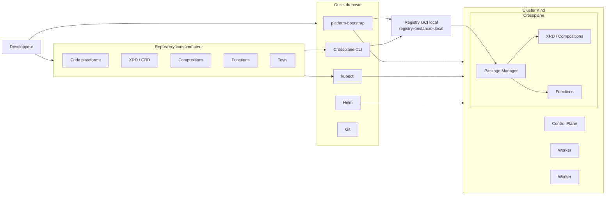

# Développement local avec Crossplane

Ce document décrit le workflow d'un développeur travaillant sur un projet de plateforme utilisant Crossplane et consommant `platform-bootstrap` comme environnement local autonome.

Le bootstrap n'est pas embarqué dans le repository applicatif. Il est installé séparément et appelé depuis le projet consommateur.

## 1. Vue d'ensemble

Exemple avec un projet consommateur nommé `agentic-platform` :

```text
agentic-platform/
├── platform/
├── components/
├── release/
├── docs/
└── .gitlab-ci.yml
```

Le bootstrap est installé ailleurs sur le poste :

```text
platform-bootstrap/
├── bin/
├── core/
└── ai/
```

Le développeur travaille depuis `agentic-platform` et appelle simplement :

```bash
platform-bootstrap -n agentic-platform bootstrap
```

## 2. Architecture locale



Le workflow cible est :

```text
bootstrap local
    ↓
initialisation / modification du projet
    ↓
tests unitaires
    ↓
crossplane project build
    ↓
push OCI
    ↓
installation dans Crossplane
    ↓
validation XRD / Composition / Functions
    ↓
création d'une XR
    ↓
réconciliation
    ↓
test fonctionnel réel
```

## 3. Préparer l'environnement

Depuis le repository consommateur :

```bash
cd ~/agentic-platform
```

Vérifier les prérequis :

```bash
platform-bootstrap -n agentic-platform doctor
```

Créer l'environnement :

```bash
platform-bootstrap -n agentic-platform bootstrap
```

Vérifier :

```bash
platform-bootstrap -n agentic-platform verify
```

Une installation correcte se termine par :

```text
Bootstrap READY.
```

## 4. Utiliser des ports alternatifs

Si plusieurs instances doivent tourner simultanément :

```bash
KIND_HTTP_PORT=8080 \
KIND_HTTPS_PORT=8443 \
REGISTRY_PORT=5001 \
platform-bootstrap -n another-platform bootstrap
```

Le state de chaque instance est isolé sous :

```text
~/.local/state/platform-bootstrap/<instance>/
```

## 5. Initialiser un projet Crossplane

Pour un nouveau projet :

```bash
crossplane project init
```

Le projet peut contenir notamment :

- des XRD ;
- des Compositions ;
- des Functions embarquées ;
- les dépendances du projet ;
- `crossplane-project.yaml`.

Le repository OCI cible doit pointer vers le registry de l'instance locale.

Exemple :

```yaml
spec:
  repository: registry.agentic-platform.local:5000/agentic-platform/crossplane-model-serving
```

Le repository utilisé au build et au push doit rester cohérent, car il influence notamment les références des Functions embarquées.

## 6. Développer et tester une Function

Les tests unitaires doivent rester indépendants de Kubernetes autant que possible.

Pour une Function Go :

```bash
go test ./...
```

Les tests doivent notamment couvrir :

- la lecture de la XR observée ;
- la génération des ressources désirées ;
- les champs obligatoires ;
- les valeurs par défaut ;
- les erreurs attendues ;
- les cas limites significatifs.

Le cluster local intervient ensuite pour les tests d'intégration.

## 7. Construire le projet

Depuis le projet Crossplane :

```bash
crossplane project build
```

Le CLI :

1. collecte les ressources ;
2. résout les dépendances ;
3. génère les schemas ;
4. construit les Functions embarquées ;
5. construit la Configuration ;
6. produit le package dans `_output/`.

Exemple :

```text
_output/crossplane-model-serving.xpkg
```

## 8. Publier dans le registry OCI local

Exemple :

```bash
crossplane project push \
  --tag=v0.1.0 \
  --insecure-skip-tls-verify
```

`--insecure-skip-tls-verify` concerne uniquement la CLI locale tant que la CA du registry n'est pas intégrée au trust système du poste.

Le cluster Kind et Crossplane utilisent la CA générée et gérée par `platform-bootstrap`.

### Vérifier le registry

```bash
curl \
  --cacert ~/.local/state/platform-bootstrap/agentic-platform/registry/certs/domain.crt \
  https://registry.agentic-platform.local:5000/v2/_catalog
```

Exemple de repositories :

```text
agentic-platform/crossplane-model-serving
agentic-platform/crossplane-model-serving_compose-vllm
```

## 9. Installer la Configuration dans Crossplane

Créer un manifest :

```yaml
apiVersion: pkg.crossplane.io/v1
kind: Configuration
metadata:
  name: crossplane-model-serving
spec:
  package: registry.agentic-platform.local:5000/agentic-platform/crossplane-model-serving:v0.1.2
```

Puis :

```bash
kubectl --context kind-agentic-platform apply -f configuration.yaml
```

Suivre l'installation :

```bash
kubectl --context kind-agentic-platform \
  get configurations.pkg.crossplane.io -w
```

État attendu :

```text
INSTALLED   HEALTHY
True        True
```

## 10. Vérifier les artefacts installés

### Configurations

```bash
kubectl --context kind-agentic-platform \
  get configurations.pkg.crossplane.io
```

### Functions

```bash
kubectl --context kind-agentic-platform \
  get functions.pkg.crossplane.io
```

Les Functions doivent être :

```text
INSTALLED=True
HEALTHY=True
```

### XRD

```bash
kubectl --context kind-agentic-platform get xrd
```

Les XRD doivent être établies :

```text
ESTABLISHED=True
```

### Compositions

```bash
kubectl --context kind-agentic-platform get compositions
```

Vérifier que la Composition cible référence le bon `XR-KIND` et la bonne `XR-APIVERSION`.

### Conditions détaillées

```bash
kubectl --context kind-agentic-platform \
  get configuration.pkg.crossplane.io <name> \
  -o jsonpath='{range .status.conditions[*]}{.type}{" => "}{.status}{" | "}{.reason}{" | "}{.message}{"\n"}{end}'
```

## 11. Tester le pull OCI depuis un node

Pour isoler les problèmes registry/containerd de Crossplane :

```bash
docker exec agentic-platform-worker2 \
  ctr -n k8s.io images pull \
  --hosts-dir /etc/containerd/certs.d \
  registry.agentic-platform.local:5000/agentic-platform/crossplane-model-serving_compose-vllm:v0.1.2
```

Ce test permet de diagnostiquer :

- DNS ;
- TLS ;
- `hosts.toml` ;
- registry OCI ;
- containerd.

## 12. Instancier une XR

Une fois la Configuration installée et saine, créer une XR conforme à l'XRD exposée.

Exemple `ModelServing` :

```yaml
apiVersion: serving.agentic-platform.io/v1alpha1
kind: ModelServing
metadata:
  name: qwen-test
spec:
  model: Qwen/Qwen3-0.6B
  runtime: vllm
```

Application :

```bash
kubectl --context kind-agentic-platform \
  apply -f model-serving.yaml
```

Suivre la XR :

```bash
kubectl --context kind-agentic-platform \
  get modelserving qwen-test
```

Conditions détaillées :

```bash
kubectl --context kind-agentic-platform \
  get modelserving qwen-test \
  -o jsonpath='{range .status.conditions[*]}{.type}{" => "}{.status}{" | "}{.reason}{" | "}{.message}{"\n"}{end}'
```

## 13. Séparer test du control plane et test fonctionnel

L'installation d'une Configuration Crossplane peut être validée sans disposer du runtime final qu'elle orchestrera.

Pour `ModelServing`, le socle core permet de valider :

```text
build projet
→ push OCI
→ installation Configuration
→ installation Functions
→ établissement XRD
→ installation Composition
```

La création réelle d'une XR `ModelServing` déclenche ensuite les ressources du runtime vLLM.

Le test end-to-end nécessite donc que l'extension IA du bootstrap soit installée au préalable.

Cette séparation distingue :

```text
tests du control plane Crossplane
```

et :

```text
tests fonctionnels de la plateforme IA
```

## 14. Vérifier les ressources composées

Après création de la XR :

```bash
kubectl --context kind-agentic-platform get modelserving
```

Puis selon la Composition :

```bash
kubectl --context kind-agentic-platform get deployments
kubectl --context kind-agentic-platform get services
```

Pour suivre la réconciliation :

```bash
kubectl --context kind-agentic-platform describe modelserving <name>
```

Logs Crossplane :

```bash
kubectl --context kind-agentic-platform \
  logs -n crossplane-system deployment/crossplane
```

## 15. Test fonctionnel end-to-end

Une fois le runtime IA disponible :

```text
XR ModelServing
    ↓
Composition
    ↓
Function compose-vllm
    ↓
Deployment vLLM
    ↓
Service
    ↓
Pod Ready
    ↓
API compatible OpenAI
    ↓
requête d'inférence
```

Le test final doit vérifier :

1. la XR est `Ready` ;
2. les ressources composées sont créées ;
3. le pod vLLM est `Ready` ;
4. le Service répond ;
5. une requête d'inférence retourne une réponse valide.

Exemple :

```bash
curl http://localhost:8000/v1/chat/completions \
  -H 'Content-Type: application/json' \
  -d '{
    "model": "Qwen/Qwen3-0.6B",
    "messages": [
      {
        "role": "user",
        "content": "Réponds uniquement par : agentic-platform-ok"
      }
    ],
    "temperature": 0,
    "max_tokens": 32
  }'
```

## 16. Cycle de développement recommandé

```text
modifier code / manifests
        ↓
tests unitaires
        ↓
crossplane project build
        ↓
crossplane project push
        ↓
installation / mise à jour du package
        ↓
validation Configuration / Functions / XRD / Composition
        ↓
création XR
        ↓
validation des ressources composées
        ↓
test fonctionnel
```

Pour repartir d'un environnement vide :

```bash
platform-bootstrap -n agentic-platform destroy
platform-bootstrap -n agentic-platform bootstrap
platform-bootstrap -n agentic-platform verify
```

Les tests unitaires doivent rester rapides et indépendants du cluster.

Les tests nécessitant Kubernetes, Crossplane ou le registry OCI relèvent des tests d'intégration.

Les tests nécessitant le runtime réel et l'inférence relèvent des tests end-to-end.
